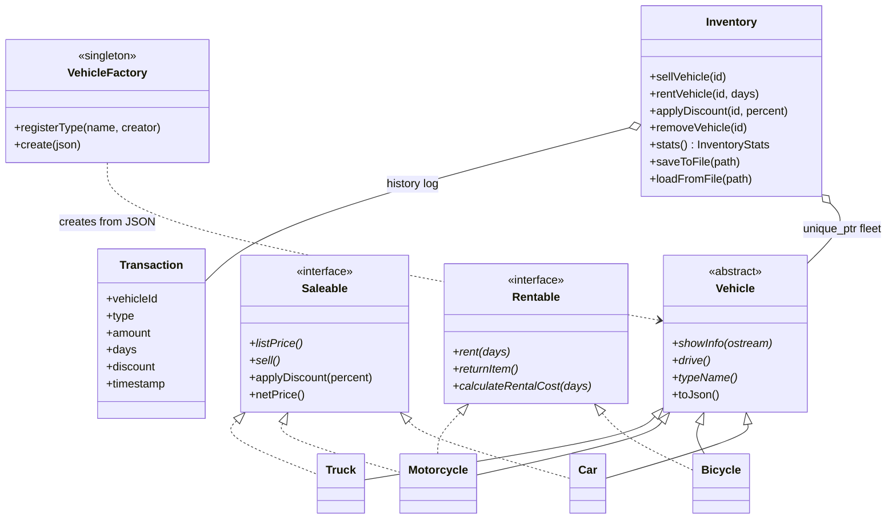

# 🚗 Vehicle Rental & Sales System

[](https://github.com/Abolfazlrwm/Vehicle/actions/workflows/ci.yml)


A dealership management system in modern C++ that both **sells** and
**rents** vehicles — cars, bicycles, motorcycles and trucks — with
polymorphic business rules, discount promotions, JSON persistence,
transaction analytics, CSV export, and a fully automated CI pipeline.

Started as a class exercise in OOP and multiple inheritance; rebuilt from
the ground up into a reference example of how a "simple" C++ project
should actually be engineered.

---

## Why this project exists

Most "vehicle store" class exercises stop at printing `showInfo()` to a
console. This one is engineered like a real codebase, and every design
decision is deliberate:

| Design point | What it means in code |
|---|---|
| **Interface segregation** | `Saleable` and `Rentable` are independent interfaces. A `Car` only sells, a `Bicycle` only rents, a `Motorcycle` does both — no class is forced to implement behaviour it doesn't have. |
| **RAII ownership** | The fleet is a `std::vector<std::unique_ptr<Vehicle>>`. There is no raw `new`/`delete` anywhere; copying a vehicle isn't even possible (copy/move are deleted). |
| **Stateful mixin** | Discount maths lives once in the `Saleable` interface — three sellable classes share tested `applyDiscount()` / `netPrice()` logic instead of copy-pasting it. |
| **Registry factory** | Deserialization goes through a `VehicleFactory` registry — no `if (type == "Car") … else if …` chains. |
| **Polymorphic core** | `Inventory` uses `dynamic_cast<Saleable*>` / `dynamic_cast<Rentable*>`, so it is written against *capabilities*, not concrete types. |
| **Atomic persistence** | Every save writes a `.tmp` file and renames it; a crash can never leave truncated JSON behind. Corrupt files are reported, not fatal. |
| **Zero-warning builds** | `-Wall -Wextra -Wpedantic` (MSVC: `/W4 /permissive-`) on every target. |
| **Presentation ≠ logic** | `showInfo(std::ostream&)` writes to any stream — unit tests capture it with a `std::ostringstream`. |

**Proof the design scales:** the `Truck` class (v2.0.0) was added by
writing the class + one `registerType` line — `Inventory` needed **zero
changes**.

## Architecture



```
include/            Public headers (Vehicle, Saleable, Rentable, Car,
                     Bicycle, Motorcycle, Truck, VehicleFactory,
                     Transaction, Inventory, Cli)
src/                Implementations + main.cpp (interactive CLI)
tests/              doctest suites: vehicles, inventory, factory
data/               Runtime JSON storage (git-ignored)
.github/workflows/  CI: build matrix, sanitizers, format check
```

## Features

- Add, list, **search** (factory / model / color / type / id, all
  case-insensitive), and **delete** vehicles
- **Sell** cars, motorcycles and trucks — with **discount promotions**
- **Rent** bicycles and motorcycles for N days, and return them later
- **Test-drive** any vehicle (the polymorphic `drive()` in action)
- **Statistics dashboard** — fleet by type and status, revenue split by
  sales vs. rentals
- **Revenue report** with timestamped, discount-annotated history that
  **survives restarts**
- **CSV export** of the full transaction log
- **Save/load** with atomic writes and self-seeding demo fleet
- Colors, money formatting (`$1,899.50`) and full input validation

## Build & run

Requires a C++17 compiler and CMake ≥ 3.16. Dependencies
([nlohmann/json](https://github.com/nlohmann/json),
[doctest](https://github.com/doctest/doctest)) are fetched and
checksum-pinned automatically — no manual installs.

```bash
git clone https://github.com/Abolfazlrwm/Vehicle.git
cd Vehicle
cmake -S . -B build -DCMAKE_BUILD_TYPE=Release
cmake --build build --parallel

./build/vehicle_app      # interactive CLI
./build/vehicle_tests    # 24 test cases / 166 assertions
```

### CLI options

```text
--help          Show usage and exit
--version       Print version and exit
--data-dir DIR  Where to store inventory.json / transactions.json (default ./data)
--no-color      Disable ANSI colors
--demo          Run a scripted demo session (nothing is saved)
```

## Example session

```text
No saved data found — seeded a demo fleet (4 vehicles).
==========================================================
   VEHICLE  RENTAL  &  SALES  SYSTEM   v2.0.0
      C++17  |  RAII  |  JSON persistence
==========================================================

Choose an option: 1
[Car #1] Toyota Corolla (2022, White) - 180 km/h - $21,000 [AVAILABLE]
[Bicycle #2] Giant Escape 3 (2023, Black) - 30 km/h - $8/day [AVAILABLE]
[Motorcycle #3] Honda CB500X (2021, Red) - 170 km/h - $7,200 to buy / $45 per day [AVAILABLE]
[Truck #4] Volvo FH16 (2023, Blue) - 140 km/h - 25t cargo - $118,000 [AVAILABLE]

Choose an option: 8        # apply a discount
Vehicle ID to discount: 1
Discount percent (0-99): 10
Choose an option: 4        # sell it
Vehicle ID to sell: 1
Sold for $18,900.

Choose an option: 10       # statistics dashboard
======== Statistics Dashboard ========
Fleet size:        4
  By type:         Bicycle x1  Car x1  Motorcycle x1  Truck x1
  Available:       2
  Sold:            1
  Rented:          1
Transactions:      2  (sales: 1, rents: 1, returns: 0)
Sales revenue:     $18,900
Rental revenue:    $135
Total revenue:     $19,035
=======================================

Choose an option: 11       # revenue report
===== Revenue Report =====
[2026-11-02 15:03:59] SALE - Corolla (#1) - $18,900 (10% off)
[2026-11-02 15:03:59] RENT - CB500X (#3) - $135 (3 days)
---------------------------
Total revenue: $19,035
===========================
```

## Data on disk

`data/inventory.json` after a typical run — the `"type"` field is what
the factory dispatches on:

```json
[
  {
    "id": 1,
    "type": "Motorcycle",
    "factory": "Honda",
    "model": "CB500X",
    "color": "Red",
    "makeYear": 2021,
    "maxSpeed": 170,
    "price": 7200.0,
    "rentPricePerDay": 45.0,
    "sold": false,
    "rented": true,
    "discountPercent": 0.0
  }
]
```

## Testing

Three suites, one executable — vehicle state machines, inventory flows
(including corrupt-file and round-trip persistence) and the factory
registry:

```bash
ctest --test-dir build --output-on-failure
```

CI runs the suite on Linux / macOS / Windows (Release), under
**AddressSanitizer + UBSanitizer**, and fails on any clang-format diff.

## Roadmap

- [ ] REST API (cpp-httplib / Crow) in front of the same `Inventory` core
- [ ] Rental due-dates and overdue detection
- [ ] SQLite backend behind the same save/load interface
- [ ] Code-coverage badge (gcovr)

## Contributing

PRs are welcome — see [CONTRIBUTING.md](CONTRIBUTING.md) for the ground
rules (tests required, clang-format enforced, no raw `new`/`delete`).
See [CHANGELOG.md](CHANGELOG.md) for the version history.

## License

MIT — see [LICENSE](LICENSE).
